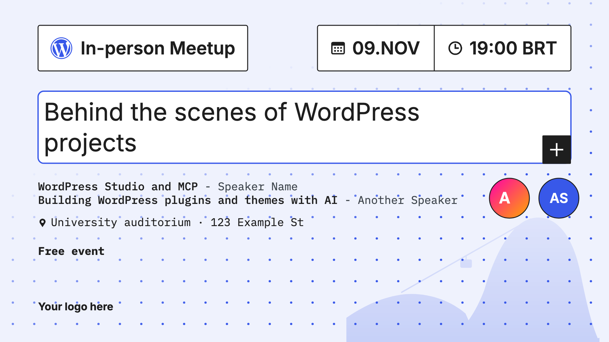

# Meetup Artwork Generator

[](https://playground.wordpress.net/?blueprint-url=https://raw.githubusercontent.com/caiohferreiradev/meetup-artwork-generator/main/playground/blueprint.json)

Standardized artwork and announcement texts for WordPress community meetups, ready for Meetup.com, Facebook, Instagram, LinkedIn, X and WhatsApp. Made by and for the WordPress community in Brazil, usable anywhere.



## Try it

Click **Open in WordPress Playground** above. A WordPress site opens in your browser with the generator as the front page. Nothing to install, and nothing you fill in leaves your browser.

To run it on your own computer:

```bash
tools/build-playground-bundle.sh
npx @wp-playground/cli server --blueprint=dist/meetup-artwork-generator-playground.zip
```

Or install the plugin on any WordPress 6.5+ site: download the zip from [Releases](https://github.com/caiohferreiradev/meetup-artwork-generator/releases) and upload it in **Plugins → Add New → Upload Plugin**. On activation the generator becomes the front page; deactivating restores the previous one.

## What organizers get

- A guided form: city (searchable), event type, date, time and time zone, meetup title, talks with speaker photos, venue and supporter logos.
- A live preview and PNG downloads in 7 formats: Meetup.com, Facebook event cover, link post, X, square, portrait and Status/Stories.
- Light and dark artwork, with a local landmark silhouette or your own image as a watermark.
- Ready-to-copy announcement texts for each network, following its best practices.
- Portuguese, English and Spanish, following the browser language.

## Contributing

Contributions are welcome, especially from communities outside Brazil.

- **New city or landmark:** add the city to `includes/cities.php` and a single-color SVG to `assets/landmarks/`. See the FAQ in [`readme.txt`](readme.txt).
- **New language:** start from `languages/meetup-artwork-generator.pot`, add your translations to `tools/translations.py` and run `python3 tools/translations.py .`
- **Bugs and ideas:** open an issue.

### Automated checks

Requirements: Node.js 20.18 or newer, npm, PHP 7.4 or newer, and internet access to download the browser and WordPress. Run from the plugin directory:

```bash
npm ci
npx playwright install chromium
npm run lint
npm test
```

The tests start a disposable WordPress Playground server and copy the plugin into it; no existing WordPress site or Docker installation is used. By default they run WordPress 6.5.14 with PHP 7.4. To match the second CI configuration, run `WP_VERSION=7.1.4 PHP_VERSION=8.3 npm test`. Both versions are pinned in CI. The suite covers saved drafts, image controls, artwork rendering and downloads, and plugin activation and deactivation. On failure, Playwright saves traces and screenshots in `test-results/`; CI uploads the HTML report and results.

Some regression tests are marked as expected failures while issues [#2](https://github.com/fellyph/meetup-artwork-generator/issues/2), [#4](https://github.com/fellyph/meetup-artwork-generator/issues/4), [#5](https://github.com/fellyph/meetup-artwork-generator/issues/5), [#6](https://github.com/fellyph/meetup-artwork-generator/issues/6), and [#7](https://github.com/fellyph/meetup-artwork-generator/issues/7) remain open. Playwright reports an unexpected pass as a failure: when a bug is fixed, remove the corresponding `test.fail` annotation. The quota test documents the current text-only fallback; warnings and image recovery are tracked in [#3](https://github.com/fellyph/meetup-artwork-generator/issues/3).

Build the distribution bundle with `tools/build-playground-bundle.sh`. Development dependencies, test fixtures, and reports are excluded from the plugin ZIP via `.distignore`.

## Português

Gerador de artes e textos de divulgação para meetups das comunidades WordPress. Clique em **Open in WordPress Playground** para usar no navegador; o gerador abre no idioma do seu navegador e dá para trocar no topo da página.

## License

GPL-2.0-or-later. Fonts: Inter and IBM Plex Mono, SIL Open Font License 1.1 (see `assets/fonts/`).
